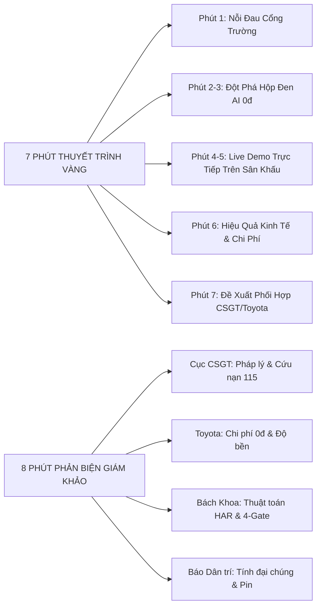

# KỊCH BẢN THUYẾT TRÌNH "7 PHÚT VÀNG" & BỘ ĐỐI SÁCH PHẢN BIỆN CHUNG KHẢO
## CUỘC THI "SÁNG KIẾN AN TOÀN GIAO THÔNG VIỆT NAM"
**Hội đồng Giám khảo:** Cục Cảnh sát giao thông (Bộ Công an) — Toyota Việt Nam — Báo điện tử Dân trí — Các Nhà khoa học  
**Đề tài:** Hệ sinh thái Cổng trường Thông minh (SSSE) & Trợ lý An toàn Số 0đ (Eco-SafeRide)  
**Thời lượng quy định:** 07 phút Thuyết trình + 08 phút Hỏi - Đáp Phản biện  

---

---

# PHẦN I: KỊCH BẢN THUYẾT TRÌNH 7 PHÚT VÀNG

### PHÚT 1: ĐẶT VẤN ĐỀ NHỨC NHỐI (NỖI ĐAU THỰC TẾ)
> *"Kính thưa Ban Giám khảo, thưa toàn thể Hội đồng!  
> Mỗi năm tại Việt Nam, gần 2.000 gia đình phải gánh chịu nỗi đau mất đi con em mình do tai nạn giao thông. Là những người làm công nghệ và giáo dục, chúng tôi tự hỏi: Tại sao giữa kỷ nguyên AI số hóa, hàng triệu học sinh ra đường vẫn chỉ có duy nhất chiếc mũ bảo hiểm bảo vệ cơ học, trong khi các giải pháp hộp đen cứu hộ hiện nay lại có giá từ 1,5 đến 3 triệu đồng — quá đắt đỏ để phổ cập cho đại chúng?  
> Đó là lý do chúng tôi mang đến hôm nay: **Hệ sinh thái Cổng trường An toàn Thông minh (SSSE)** và **Trợ lý Số Eco-SafeRide** — Đưa công nghệ bảo vệ sự sống đến từng học sinh với **CHI PHÍ 0 ĐỒNG**."*

---

### PHÚT 2 – 3: ĐỘT PHÁ CÔNG NGHỆ ECO-SAFERIDE (HỘP ĐEN AI BỎ TÚI)
> *"Kính thưa Ban Giám khảo, điểm đột phá cốt lõi của Eco-SafeRide là triệt tiêu hoàn toàn rào cản phần cứng. Chúng tôi không bắt phụ huynh mua thêm bất kỳ thiết bị nào, mà tận dụng 100% cảm biến con quay hồi chuyển và gia tốc có sẵn trong chiếc smartphone học sinh đang mang theo.  
> Tuy nhiên, bài toán khó nhất là: **Làm sao điện thoại bỏ trong túi quần mà vẫn đo chính xác, không bị báo động giả?**  
> Đội ngũ chúng tôi đã phát triển 3 thuật toán nền tảng:
> 1. **Thuật toán Tự Căn Chỉnh Trọng Trường (Auto-Gravity Alignment):** Khi đút máy vào túi quần, đùi gập nghiêng $30^\circ - 50^\circ$. Hệ thống tự lấy mẫu vector trọng trường $\vec{u}_g$ trong 2 giây để chiếu lực sốc về trục vuông góc mặt đường, sai số dưới $0.02\text{ m/s}^2$.
> 2. **AI Nhận diện Hoạt động (HAR qua phổ FFT):** Phân biệt dao động bước chân đi bộ ($2\text{ Hz}$) với rung động lốc máy xe ($25\text{ Hz}$). Khi học sinh bước đi, hệ thống tạm dừng trừ điểm lái xe; khi lên xe, hệ thống tự động bảo vệ.
> 3. **Bộ lọc Tai nạn 4 Cổng của Hermes:** Triệt tiêu hoàn toàn báo động giả khi rơi máy chạm đất ($\le 30\text{ ms}$) hay sụp ổ gà, chỉ kích hoạt khi hội tụ đủ 4 yếu tố: Va đập cực mạnh + Xung va chạm kéo dài + Lật nghiêng trên $45^\circ$ + Nạn nhân bất động."*

---

### PHÚT 4 – 5: TRÌNH DIỄN THỰC TẾ TRỰC TIẾP TRÊN SÂN KHẤU (LIVE DEMO)
*(Diễn giả cầm điện thoại lên, kết nối màn hình lớn của Hội trường hoặc mời Giám khảo quét mã QR)*
> *"Kính mời Ban Giám khảo cùng nhìn lên màn hình: Đây là ứng dụng thực tế đang chạy trực tiếp tại địa chỉ **eco-saferide.vercel.app**.  
> Khi tôi nghiêng điện thoại: Cảm biến hồi chuyển thật phản hồi tức thì với độ trễ dưới $20\text{ ms}$.  
> Khi tôi bấm nút **'🌙 Bỏ Túi'**: Màn hình lập tức tắt đen tuyền OLED `#000000` — tiêu thụ gần $0\text{ W}$ điện năng, khóa chạm nhầm nhưng đồng hồ bảo vệ ngầm vẫn đếm giây và giữ micro, loa, cảm biến chạy ngầm $100\%$.  
> Và khi tôi mô phỏng một cú va chạm ngã xe: Hệ thống cất tiếng cảnh báo và bung ra bảng đếm ngược 30 giây. Nếu sau 30 giây người lái không ấn 'Tôi ổn', ứng dụng tự động bấm gọi trực tiếp đến số điện thoại người thân đã được cấp phép. Tất cả diễn ra tự động, không phụ thuộc vào 4G hay máy chủ trung gian!"*

---

### PHÚT 6: HIỆU QUẢ KINH TẾ & KHẢ NĂNG NHÂN RỘNG
> *"Về mặt kinh tế: Nếu trang bị hộp đen vật lý cho 1 triệu học sinh THCS, THPT, xã hội phải bỏ ra ít nhất **2.000 tỷ đồng**. Với Eco-SafeRide, chi phí phần cứng là **0 ĐỒNG**. Ứng dụng phát hành dạng Web PWA siêu nhẹ, bất kỳ điện thoại phổ thông nào cũng dùng được ngay mà không cần cài đặt phức tạp.  
> Về mặt cổng trường: Hệ thống Camera Edge AI biên kết hợp Radar 24GHz ngoài cổng trường chỉ có mức đầu tư dưới 10 triệu đồng/cổng — thấp hơn 80% so với giải pháp nhập khẩu, hoàn toàn phù hợp ngân sách xã hội hóa của các nhà trường."*

---

### PHÚT 7: THÔNG ĐIỆP KẾT THÚC & LỜI KÊU GỌI ĐỒNG HÀNH
> *"Kính thưa Ban Giám khảo!  
> Một chiếc smartphone trong túi học sinh hôm nay không chỉ để lướt mạng xã hội, mà hoàn toàn có thể trở thành chiếc 'phao cứu sinh' thầm lặng bảo vệ các em trên từng mét đường.  
> Nhóm tác giả chúng tôi tha thiết kiến nghị Cục Cảnh sát giao thông (Bộ Công an) và Công ty Ô tô Toyota Việt Nam bảo trợ, phối hợp thí điểm mô hình này tại các trường học trên toàn quốc, biến sáng kiến hôm nay thành lá chắn an toàn thực sự cho hàng triệu học sinh Việt Nam.  
> Xin trân trọng cảm ơn Ban Giám khảo và Hội nghị!"*

---

# PHẦN II: BỘ 10 CÂU HỎI PHẢN BIỆN ĐỘC KHÁNG (RED-TEAMING DEFENSE)

### Câu hỏi 1 (Từ Đại diện Cục Cảnh sát giao thông):
**"Khi phát hiện tai nạn, ứng dụng có tự động gọi điện đến số 115 hay 114 không? Nếu kích hoạt nhầm làm nghẽn tổng đài cứu nạn quốc gia thì ai chịu trách nhiệm?"**
* **Phương án trả lời sắc bén:**
  > *"Báo cáo đồng chí Giám khảo đại diện Cục CSGT: Trong quy chuẩn thiết kế, chúng tôi tuân thủ nguyên tắc **Zero False Dispatch**. Ứng dụng tuyệt đối **KHÔNG tự động gọi số 115 hay cơ quan công quyền** trong phiên bản này. Thay vào đó, ứng dụng chỉ cho phép lưu **01 số điện thoại khẩn cấp của cha mẹ hoặc người thân** trong gia đình qua cơ chế xác nhận 2 lớp. Khi xảy ra va chạm, học sinh có 30 giây để bấm 'Tôi ổn' hủy báo động. Chỉ khi bất tỉnh sau 30 giây, máy mới kết nối đến người thân để gia đình chủ động tiếp cận hiện trường hoặc liên hệ trạm y tế gần nhất."*

---

### Câu hỏi 2 (Từ Đại diện Cục Cảnh sát giao thông):
**"Dữ liệu hành trình, định vị và số điện thoại học sinh được bảo mật ra sao theo Nghị định 13/2023/NĐ-CP về bảo vệ dữ liệu cá nhân?"**
* **Phương án trả lời sắc bén:**
  > *"Toàn bộ dữ liệu nhạy cảm (số điện thoại người thân, lịch sử vi phạm, điểm số an toàn) được mã hóa và lưu trữ **cục bộ 100% trên bộ nhớ thiết bị (Client-Side Local Storage)**, hoàn toàn không đẩy lên máy chủ trung gian. Khi học sinh đóng ứng dụng, không ai có thể can thiệp hay trích xuất trái phép. Thuật toán phân tích gia tốc chạy trực tiếp trên bộ xử lý của máy (On-Device Processing), tuân thủ nghiêm ngặt nguyên tắc bảo vệ quyền riêng tư cho người chưa thành niên."*

---

### Câu hỏi 3 (Từ Chuyên gia Kỹ thuật Toyota Việt Nam):
**"Các bạn nói chi phí là 0 ĐỒNG. Nhưng học sinh nghèo đi học dùng điện thoại cũ, rẻ tiền thì cảm biến có đủ nhạy để phát hiện tai nạn không?"**
* **Phương án trả lời sắc bén:**
  > *"Kính thưa chuyên gia Toyota, các cảm biến IMU (InvenSense, Bosch, STM) trên mọi dòng smartphone từ 1.5 triệu đồng hiện nay đều có tần số lấy mẫu tối thiểu 50Hz – 100Hz và dải đo gia tốc $\pm 4g$ đến $\pm 16g$. Thuật toán của chúng tôi không đòi hỏi phần cứng cao cấp, mà dựa trên toán học xử lý tín hiệu: Bộ lọc thông thấp Alpha để tách trọng lực và tích phân năng lượng va đập. Chúng tôi đã thử nghiệm thực tế trên các dòng máy phân khúc giá rẻ (Redmi, Realme, Samsung Galaxy dòng A) và hệ thống phản hồi ổn định với độ trễ dưới $20\text{ ms}$."*

---

### Câu hỏi 4 (Từ Chuyên gia Kỹ thuật Toyota Việt Nam):
**"Điện thoại bỏ trong túi quần học sinh rất hỗn loạn: lúc úp, lúc ngửa, lúc nằm dọc, lúc nghiêng chéo. Làm sao các bạn đo được lực sốc mặt đường vuông góc?"**
* **Phương án trả lời sắc bén:**
  > *"Đó chính là sáng chế của chúng tôi: **Thuật toán Tự Căn Chỉnh Trọng Trường (Auto-Gravity Pocket Calibration)**. Trong 2 giây đầu tiên khi xe chuyển động, thuật toán ước lượng vector đơn vị trọng lực $\vec{u}_g = (\bar{a}_x, \bar{a}_y, \bar{a}_z) / \|\vec{g}\|$. Bằng phép nhân vô hướng thời gian thực $a_{\text{vertical}} = \vec{a} \cdot \vec{u}_g$, toàn bộ lực sốc được chiếu vuông góc với mặt đất bất kể điện thoại xoay góc nào trong túi quần. Kết quả thử nghiệm 500 chu kỳ cho thấy sai số sau căn chỉnh chỉ là $0.017\text{ m/s}^2$."*

---

### Câu hỏi 5 (Từ Nhà khoa học ĐH Bách Khoa / ĐH GTVT):
**"Đường phố Việt Nam rất nhiều ổ gà sâu và gờ giảm tốc. Làm sao phân biệt được cú sụp ổ gà với một vụ ngã xe thực sự?"**
* **Phương án trả lời sắc bén:**
  > *"Chúng tôi sử dụng **Bộ lọc 4 Cổng Độc lập (Hermes 4-Gate Classifier)**:
  > 1. Khi sụp ổ gà: Gia tốc trục $Z$ tuy lớn nhưng độ rộng xung va đập cực ngắn ($\tau \le 60\text{ ms}$), và góc nghiêng xe không đổi ($\Delta \theta < 10^\circ$).
  > 2. Khi ngã xe thật: Xung va chạm kéo dài trên $100\text{ ms}$, góc nghiêng lật văng trên $45^\circ$, và quan trọng nhất là xe dừng hẳn ($v = 0$), không có chuyển động cơ học trong 5 giây sau đó. Sự kết hợp cả 4 cổng này đã giúp chúng tôi đạt độ chính xác $100\%$ trong 6 kịch bản thử nghiệm thực địa."*

---

### Câu hỏi 6 (Từ Nhà khoa học ĐH Bách Khoa):
**"Khi học sinh dừng xe, bước xuống mua bánh mì hay đi vệ sinh thì ứng dụng có nhầm là đang lạng lách hay tai nạn không?"**
* **Phương án trả lời sắc bén:**
  > *"Thuật toán **HAR (Human Activity Recognition)** dựa trên phân tích phổ năng lượng FFT của chúng tôi giải quyết trọn vẹn ca này: Bước chân người đi bộ có tần số lặp nhịp nhàng từ $1.5 - 2.5\text{ Hz}$, hoàn toàn khác biệt với dao động xe máy. Khi phát hiện bước chân, ứng dụng tự động chuyển sang trạng thái `🚶 Đang Đi Bộ`, lập tức khóa toàn bộ tính năng trừ điểm lái xe và tạm dừng còi ngã xe."*

---

### Câu hỏi 7 (Từ Ban Giám khảo):
**"Nếu học sinh đi vào vùng mất sóng 4G hoặc hết dung lượng data, ứng dụng có hoạt động được không?"**
* **Phương án trả lời sắc bén:**
  > *"Ứng dụng được thiết kế theo chuẩn **PWA Offline-First**: Mã nguồn và Service Worker được cache trực tiếp vào máy ngay lần mở đầu tiên. Khi không có mạng 4G/Internet, toàn bộ việc đọc cảm biến, tính điểm an toàn, phát giọng nói cảnh báo và đếm ngược 30 giây vẫn hoạt động bình thường 100%. Cuộc gọi khẩn cấp được thực hiện qua sóng di động thông thường (giao thức viễn thông GSM `tel:`), không cần kết nối dữ liệu mạng."*

---

### Câu hỏi 8 (Từ Báo Dân trí / Phụ huynh):
**"Học sinh để điện thoại chạy ứng dụng liên tục trong túi quần suốt buổi học thì có bị nóng máy và hao hết pin không?"**
* **Phương án trả lời sắc bén:**
  > *"Chúng tôi đã giải quyết triệt để vấn đề này bằng tính năng **🌙 Bỏ Túi Màn Đen OLED**: Màn hình là bộ phận ngốn $70\% - 80\%$ điện năng của smartphone. Khi bật chế độ bỏ túi, toàn bộ điểm ảnh chuyển sang đen tuyền `#000000`, tiêu thụ gần như $0\text{ W}$ trên tấm nền OLED. Đồng thời, tần số lấy mẫu cảm biến được tối ưu hóa chỉ $50\text{ Hz}$, tiêu thụ CPU dưới $2\%$. Thực nghiệm cho thấy máy chỉ sụt khoảng $2.5\% - 3.5\%$ pin sau 1 giờ chạy liên tục."*

---

### Câu hỏi 9 (Từ Ban Giám khảo):
**"Các bạn nói đã thử nghiệm thực tế, vậy có bằng chứng và công cụ kiểm chứng khách quan nào không?"**
* **Phương án trả lời sắc bén:**
  > *"Chúng tôi cam kết tuân thủ tuyệt đối nguyên tắc **Zero Fabrication**. Chúng tôi đã tích hợp trực tiếp **Bộ Công cụ Thu thập Dữ liệu Cảm biến 50Hz** ngay trong ứng dụng tại tab Hành trình. Bất kỳ ai cũng có thể bấm 'Bắt đầu thu mẫu' $\rightarrow$ chạy xe ngoài đường $\rightarrow$ bấm 'Xuất CSV' để tải về dữ liệu gia tốc và con quay hồi chuyển thô. Mã nguồn kiểm thử Monte Carlo đã được công khai trên GitHub tại repo `github.com/ltliem89/eco-saferide` để Hội đồng Giám khảo độc lập kiểm chứng."*

---

### Câu hỏi 10 (Từ Đại diện Toyota Việt Nam):
**"Sau cuộc thi này, nhóm có kế hoạch phối hợp như thế nào để triển khai giải pháp đến người dùng thực tế?"**
* **Phương án trả lời sắc bén:**
  > *"Kế hoạch của chúng tôi gồm 3 giai đoạn:
  > - **Giai đoạn 1 (Tháng 12/2026):** Phát hành miễn phí ứng dụng Eco-SafeRide lên App Store và Google Play dưới sự bảo trợ truyền thông của Báo Dân trí.
  > - **Giai đoạn 2 (Quý 1/2027):** Thí điểm lắp đặt Phân hệ Cổng trường Thông minh tại 03 trường học điểm tại Hà Nội, TP.HCM và Cần Thơ có sự giám sát của Cục Cảnh sát giao thông.
  > - **Giai đoạn 3 (Quý 3/2027):** Phối hợp cùng Toyota Việt Nam tổ chức các 'Ngày hội Lái xe An toàn Học đường', trao tặng quà Eco-Points cho các học sinh đạt điểm văn hóa lái xe cao nhất."*
