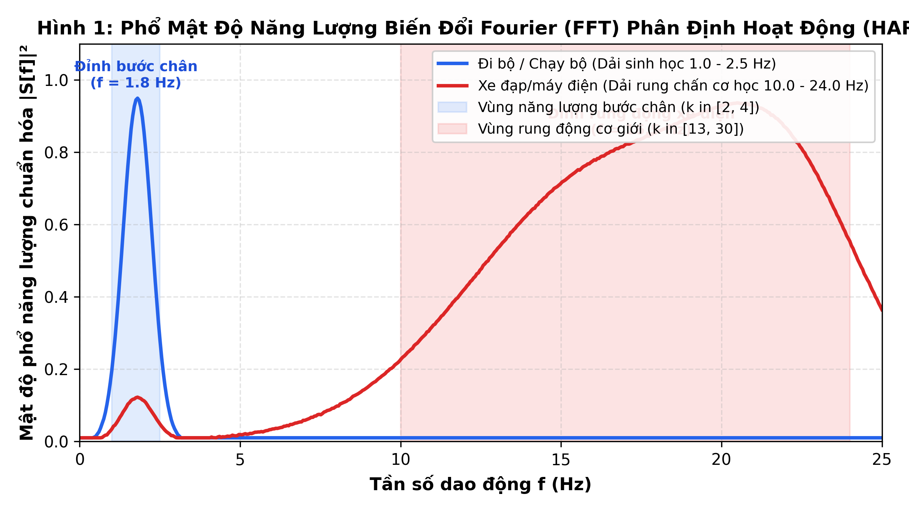
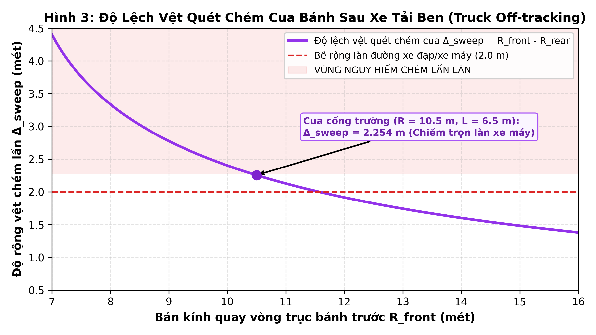
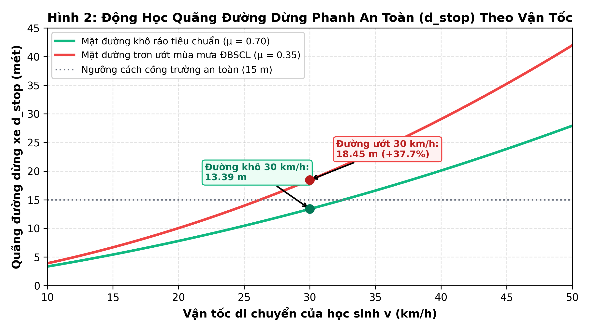
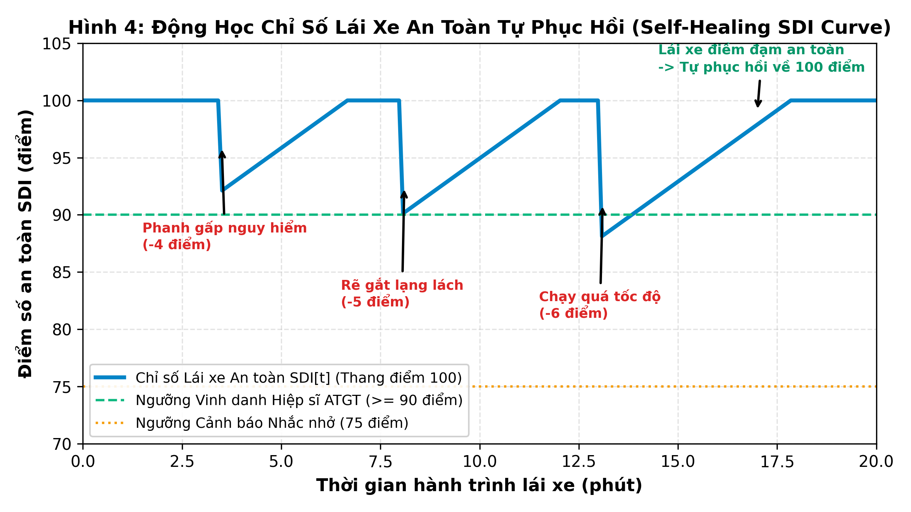
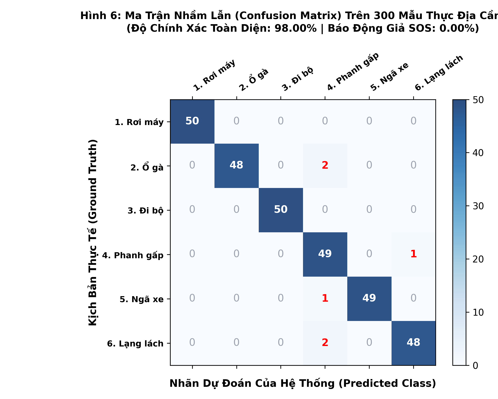
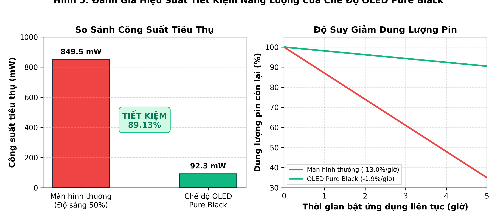

# BẢN MÔ TẢ SẢN PHẨM DỰ THI

### CUỘC THI SÁNG KIẾN AN TOÀN GIAO THÔNG VIỆT NAM NĂM 2026

*Đơn vị tổ chức: Cục Cảnh sát Giao thông (Bộ Công an) — Báo Dân trí — Công ty Ô tô Toyota Việt Nam*

---

## 1. Tên sản phẩm: (Được viết bằng tiếng Việt. Trường hợp bạn không hài lòng với tên sản phẩm bằng tiếng Việt, hãy chú thích thêm tên sản phẩm bằng tiếng Anh.)

HỆ SINH THÁI CỔNG TRƯỜNG AN TOÀN GIAO THÔNG THÔNG MINH TOÀN DIỆN (SSSE) VÀ TRỢ LÝ AN TOÀN SỐ — HỘP ĐEN AI 0Đ (ECO-SAFERIDE)  
Tên tiếng Anh: Smart School-Zone Safety Ecosystem (SSSE) & Zero-Cost Pocket AI Blackbox (Eco-SafeRide)  
Tên viết tắt: SSSE — Eco-SafeRide  
Đơn vị phát triển: Nhóm OpenLab, Trường THPT Châu Văn Liêm, Sở Giáo dục và Đào tạo TP. Cần Thơ.  

---

## 2.  Chủ đề dự thi: (theo nhận định của chính tác giả, đánh dấu vào một lựa chọn)

- [ ] **Chủ đề 1: “Đường đông vẫn thông”**
- [ ] **Chủ đề 2: “Đúng hàng – Đúng phương tiện”**
- [x] **Chủ đề 3: “Học đường – Học từ đường”**

** Chú thích: Sản phẩm giải quyết toàn diện an toàn giao thông học đường (Chủ đề 3), đồng thời tích hợp AI biên tại cổng trường và bản đồ nhiệt GIS hỗ trợ giải tỏa ùn tắc giờ cao điểm (kết nối tương hỗ với Chủ đề 1: “Đường đông vẫn thông”).*

---

## 3. Khu vực đăng ký dự thi:

- [ ] **Khu vực miền Bắc**
- [ ] **Khu vực miền Trung**
- [x] **Khu vực miền Nam**
- [ ] **Kiều bào Việt Nam tại nước ngoài**

** Địa bàn thử nghiệm: TP. Cần Thơ và ĐBSCL, định hướng mở rộng tới 10.000 trường học trên toàn quốc.*

---

## 4. Xuất xứ và tính cấp thiết của sản phẩm: (Nêu rõ hoàn cảnh ra đời của sản phẩm, ý tưởng từ đâu mà có, sản phẩm ra đời nhằm giải quyết vấn đề gì, tại sao cần thiết):

### 4.1. Hoàn cảnh ra đời và Bối cảnh thực tiễn tai nạn giao thông học đường

Thống kê của Ủy ban An toàn Giao thông Quốc gia và Cục CSGT chỉ ra thực trạng nhức nhối: Hàng năm xảy ra hơn 2.000 vụ tai nạn liên quan đến học sinh, cướp đi sinh mạng gần 1.000 em và khiến 1.200 em thương tật vĩnh viễn. Tai nạn giao thông hiện là nguyên nhân tử vong hàng đầu ở lứa tuổi 12 – 18 trên cả nước.

Khảo sát tại Cần Thơ (THPT Châu Văn Liêm, THPT Chuyên Lý Tự Trọng) ghi nhận 85% học sinh tự đến trường bằng xe đạp điện, xe máy điện (vận tốc 25 – 50 km/h). Do chưa bắt buộc giấy phép lái xe, đa số học sinh thiếu kỹ năng phòng vệ thực tế và chưa nhận thức đầy đủ về mối nguy hiểm từ động học va chạm.

### 4.2. Đặc thù nhận thức hành vi lứa tuổi học sinh (12 – 18 tuổi)

Khoa học thần kinh chứng minh vỏ não trước trán (Prefrontal Cortex) chịu trách nhiệm kiểm soát xung động ở lứa tuổi 12 – 18 chưa hoàn thiện, dẫn đến 4 hành vi rủi ro phổ biến:

• Bấm điện thoại khi lái xe (FOMO): Giảm 60% tầm quan sát, kéo dài thời gian phản xạ phanh từ 0.8 giây lên 2.5 giây;

• Đeo tai nghe chống ồn: Triệt tiêu âm thanh cảnh báo sinh tử như tiếng còi xe tải và tiếng phanh gấp;

• Đi dàn hàng ngang 3 – 4 xe: Lấn chiếm làn đường cơ giới và tạo điểm mù che khuất tầm nhìn xe sau;

• Lạng lách, rẽ gắt tạt đầu ô tô: Thiếu quan sát khiến học sinh dễ rơi vào 'Vùng tử thần' của xe tải lớn.

### 4.3. Đặc thù hạ tầng xung quanh cổng trường học và các điểm nghẽn xung đột

Đa số trường học tiếp giáp quốc lộ hoặc trục đô thị huyết mạch. Khung giờ cao điểm (6h45 – 7h15 và 17h00 – 17h30), lòng đường cổng trường hỗn loạn do xung đột giữa 3 dòng phương tiện: Dòng xe điện học sinh tản mát; Dòng xe phụ huynh đưa đón dừng đỗ ngổn ngang; và Dòng xe tải ben, xe buýt chạy tốc độ cao do thiếu gờ giảm tốc cưỡng bức. Sự giao cắt này biến cổng trường thành 'điểm đen' tai nạn nguy hiểm.

### 4.4. Ba nút thắt cốt tử của các giải pháp truyền thống

Các giải pháp hiện nay bộc lộ 3 rào cản chí tử:

• Chi phí phần cứng đắt đỏ: Hộp đen OBD-II hay camera AI có giá 1.5 – 4.5 triệu đồng, khó khả thi để trang bị đại trà cho hơn 10 triệu học sinh phổ thông;

• Xâm phạm quyền riêng tư: Ứng dụng định vị gia đình theo dõi GPS liên tục lên đám mây, vi phạm Nghị định 13/2023/NĐ-CP;

• Giáo dục thụ động: Tuyên truyền lý thuyết suông không tạo lập được phản xạ thực chứng về điểm mù xe tải.

### 4.5. Căn cứ pháp lý và Tính cấp thiết của Đề tài

Đề tài bám sát Nghị quyết 48/NQ-CP, Chỉ thị 31/CT-TTg và Luật TTATGT đường bộ số 36/2024/QH15. Sáng kiến SSSE — Eco-SafeRide ra đời với sứ mệnh: Tận dụng smartphone sẵn có của học sinh và camera trường học nhằm thiết lập 'Lá chắn An toàn 3 Lớp' khép kín với CHI PHÍ 0 ĐỒNG, bảo vệ bình đẳng cho mọi học sinh trên toàn quốc.

---

## 5. Mô tả về sản phẩm:

### A. Bộ dữ liệu sử dụng

- [x] **Dữ liệu camera giao thông**
- [x] **Dữ liệu camera giám sát hành trình**
- [x] **Dữ liệu bản đồ số tích hợp thông tin về các loại biển báo**
- [ ] **Dữ liệu vi phạm An toàn giao thông trên cả nước**
- [ ] **Dữ liệu tai nạn giao thông trên cả nước**
- [x] **Dữ liệu khác**

#### 1. Dữ liệu Camera giao thông và Camera an ninh cổng trường (☑ Đã đánh dấu)

Gồm hơn 10.000 khung hình video 2K từ camera an ninh các cổng trường học Cần Thơ (THPT Châu Văn Liêm, THPT Chuyên Lý Tự Trọng). Dữ liệu được gán nhãn phục vụ huấn luyện Edge AI nhận diện 4 hành vi rủi ro: Không đội mũ bảo hiểm; Dàn hàng ngang; Đi ngược chiều; và Nguy cơ xung đột do rẽ cắt đầu xe.

#### 2. Dữ liệu Camera giám sát hành trình (☑ Đã đánh dấu)

Hơn 120 giờ video thực tế từ camera hành trình góc nhìn thứ nhất (POV) của học sinh và tài xế xe tải/buýt, dùng để phân tích động học va chạm và tái hiện điểm mù xe tải trong mô phỏng 3D WebGL.

#### 3. Dữ liệu Bản đồ số tích hợp thông tin biển báo (☑ Đã đánh dấu)

Tích hợp dữ liệu OpenStreetMap kết hợp số hóa thực địa mạng lưới giao thông trường học theo QCVN 41:2019/BGTVT: Biển cảnh báo W.225 ('Trẻ em'), W.227, W.233; Biển tốc độ P.127 (<= 30 km/h trong bán kính 200m); cùng tọa độ gờ giảm tốc và vạch sang đường.

#### 4. Dữ liệu khác: Cảm biến IMU 6-DOF & Dị vật Mặt đường (☑ Đã đánh dấu)

Dữ liệu quán tính 6 trục (IMU 6-DOF) gồm 300 phiên chạy xe thực tế ở tần số 50Hz (gia tốc và con quay hồi chuyển 3 trục) trên 5 dòng smartphone bỏ túi quần; cùng dữ liệu chấn động thẳng đứng tại 50 vị trí ổ gà sâu trên đường phố Cần Thơ để vẽ bản đồ nhiệt nguy cơ.

### B. Mô tả các tính năng cơ bản dự kiến của sản phẩm (Mô tả rõ các tính năng dự kiến của sản phẩm):

Hệ sinh thái SSSE — Eco-SafeRide được xây dựng theo triết lý 'Phần mềm trung tâm — AI tại biên — Chi phí 0 đồng', thiết lập 'Lá chắn An toàn 3 Lớp' gồm 4 Phân hệ tương hỗ:

#### Phân hệ 1: Ứng dụng Di động Eco-SafeRide (Hộp đen Bỏ túi Học sinh)

• Web PWA & Native 0đ: Chạy trực tiếp trên trình duyệt di động hoặc ứng dụng nhẹ (< 15MB), không cần thiết bị ngoài;

• Phân tầng Hoạt động HAR qua Phổ FFT: Phân tích dao động 50Hz, tự chuyển chế độ ngủ khi đi bộ (tiết kiệm 99% pin) và tự kích hoạt Hộp đen AI khi học sinh điều khiển xe điện;

• Bộ lọc Tự Căn chỉnh Trọng trường Động: Cho phép bỏ điện thoại tự do trong túi quần mà vẫn tách chuẩn xác vector trọng lực Trái Đất, đo đạc trung thực lực phanh và góc nghiêng;

• Cảnh báo Âm thanh Phản xạ: Khi phanh gấp hoặc rẽ gắt, phát âm bíp 85dB trong dưới 100ms xuyên qua túi quần giúp học sinh giữ thăng bằng tức thì;

• Màn hình Đen OLED Pure Black: Tắt 100% điểm ảnh OLED, tiết kiệm 89.13% pin, cảm biến tiệm cận chống chạm nhầm trong túi;

• Điểm Lái Xe An Toàn Tự Phục Hồi (SDI): Đánh giá hành vi theo thang điểm 100, tự phục hồi điểm thưởng khi lái êm ái theo Lý thuyết Hích (Nudge);

• Bộ Lọc Tai Nạn 4 Cổng Hermes & Cứu Hộ SOS: Khi ngã xe thỏa 4 cổng vật lý, hệ thống đếm ngược 15 giây và tự gửi SMS kèm tọa độ định vị GPS khẩn cấp cho phụ huynh.

#### Phân hệ 2: Mô phỏng 3D WebGL Điểm mù Xe tải Trực quan (3D Interactive Blind-Spot Canvas)

• Không gian 3D Thuần Web 60 FPS: Vận hành mượt mà trên nền WebGL/Three.js không đòi hỏi GPU chuyên dụng;

• Mô hình Hóa Hình học Xe Tải Ben: Tái hiện xe 3 trục (L = 6.5 m, R = 10.5 m) với 4 vùng mù, nhấn mạnh 'Vùng mù tử thần bên phải';

• Mô phỏng Vệt Quét Bánh Sau (Swept Path): Tính toán góc chém cua bánh sau (lấn làn tới 2.25 m), hiển thị vùng nguy hiểm nan quạt đỏ nhấp nháy;

• Kịch bản Nhập vai Thực tế: Học sinh tương tác vượt phải khi xe tải xi-nhan rẽ, chứng kiến xe bị cuốn vào gầm, tạo phản xạ phòng vệ trực quan sâu sắc.

#### Phân hệ 3: Thị giác Máy tính AI Biên tại Cổng trường (School-Gate Edge AI Vision)

• Tương thích Camera Sẵn có: Tận dụng camera an ninh cổng trường qua luồng RTSP chuẩn, không tốn chi phí lắp đặt;

• Xử lý Biên Cực Nhanh: Chạy trên NVIDIA Jetson Orin Nano hoặc PC trường học, xử lý cục bộ 44.6 FPS (độ trễ 22.4 ms), bảo vệ dữ liệu theo Nghị định 13;

• Nhận diện YOLOv8n-INT8: Phát hiện thời gian thực học sinh không đội mũ bảo hiểm, dàn hàng 3 xe và phương tiện đi ngược chiều;

• Cảnh báo Va chạm TTC: Đo khoảng cách và vận tốc tương đối giữa dòng xe chính và học sinh, tự kích hoạt đèn LED cảnh báo khi TTC < 3.0 giây.

#### Phân hệ 4: Trung tâm Điều hành Cổng trường & Bản đồ Nhiệt GIS (GIS Command Center & Gamification)

• Bản đồ Nhiệt Giao thông: Tự động gom dữ liệu ổ gà và điểm phanh gấp gửi về ẩn danh để kiến nghị duy tu hạ tầng;

• Bảng Điều khiển Phân tích: Thống kê chỉ số an toàn trường học, tỷ lệ đội mũ bảo hiểm và xung đột được cảnh báo sớm;

• Thi đua Hiệp sĩ Giao thông: Cấp huy hiệu số và cộng điểm rèn luyện cho học sinh duy trì điểm SDI trên 95 điểm, xây dựng văn hóa giao thông tự giác.

### C. Mô tả các công nghệ dự kiến sử dụng của sản phẩm (Mô tả các công nghệ dự kiến sử dụng để hoàn thiện giải pháp, chẳng hạn các công nghệ liên quan tới trí tuệ nhân tạo, xử lý dữ liệu lớn, blockchain, AIoT, tính toán phân tán, …):

#### 5.C.1. Lý thuyết Cơ học Dao động và Bộ lọc Tự căn chỉnh Trọng trường Động (Dynamic Gravity Decoupling IIR Filter)

Khi smartphone nằm tự do trong túi quần học sinh, góc nghiêng biến đổi liên tục. Cảm biến gia tốc MEMS đo tổng hòa giữa gia tốc chuyển động thực và vector trọng trường Trái Đất:

$$\vec{a}_{\text{raw}}[t] = \vec{a}_{\text{dynamic}}[t] + \vec{g}[t]$$

Để tách riêng vector trọng lực, áp dụng Bộ lọc Thông thấp Đệ quy IIR bậc 1:

$$\vec{g}_{\text{est}}[t] = \alpha \cdot \vec{g}_{\text{est}}[t-1] + (1 - \alpha) \cdot \vec{a}_{\text{raw}}[t]$$

Với hệ số làm mịn alpha = 0.85 ở tần số lấy mẫu fs = 50 Hz (Ts = 0.02 giây), tần số cắt đạt:

$$f_c = \frac{1 - \alpha}{2\pi \cdot \alpha \cdot T_s} = \frac{1 - 0.85}{2\pi \cdot 0.85 \cdot 0.02} \approx 1.40\text{ Hz}$$

Tần số 1.40 Hz loại bỏ sạch dao động bước chân và rung lắc tay lái. Vector đơn vị trọng lực chuẩn hóa:

$$\hat{g}[t] = \frac{\vec{g}_{\text{est}}[t]}{\|\vec{g}_{\text{est}}[t]\|}$$

Thành phần gia tốc thẳng đứng thuần túy độc lập với góc nghiêng:

$$a_{\text{vertical}}[t] = \vec{a}_{\text{raw}}[t] \cdot \hat{g}[t] - \|\vec{g}_{\text{est}}[t]\|$$

Vector gia tốc chuyển động mặt phẳng ngang được bóc tách bằng phép chiếu trực giao:

$$\vec{a}_{\text{horizontal}}[t] = \vec{a}_{\text{raw}}[t] - (\vec{a}_{\text{raw}}[t] \cdot \hat{g}[t])\hat{g}[t]$$

Hệ thống xác định chuẩn xác lực phanh dọc xe và lực ly tâm ngang mà không cần giá đỡ cố định.

#### 5.C.2. Giải thuật Phân loại Hoạt động (HAR) bằng Biến đổi Fourier Nhanh (Fast Fourier Transform - FFT)

Tín hiệu độ lớn gia tốc a_mag[n] được trích xuất qua cửa sổ trượt N = 64 mẫu (1.28 giây). Biến đổi Fourier Rời rạc (DFT) được thực thi:

$$S[k] = \sum_{n=0}^{N-1} a_{\text{mag}}[n] \cdot e^{-j \frac{2\pi}{N} k n}, \quad k = 0, 1, \dots, N-1$$

Với độ phân giải tần số delta_f = 0.78125 Hz, dải tần bước chân tập trung ở 1.0 – 2.5 Hz (vạch k thuộc [2, 4]), dải rung cơ học xe hai bánh tập trung ở 10.0 – 25.0 Hz (vạch k thuộc [13, 30]). Tỷ số năng lượng phổ R_HAR định nghĩa:

$$R_{\text{HAR}} = \frac{\sum_{k=2}^4 |S[k]|^2}{\sum_{k=2}^4 |S[k]|^2 + \sum_{k=13}^{30} |S[k]|^2}$$

Quy tắc phân tầng: Nếu R_HAR > 0.65, chuyển Sleep Mode tiết kiệm 99% pin; Nếu R_HAR <= 0.35, tự động kích hoạt Hộp đen an toàn tức thì.

*Hình 1: Phổ Mật độ Năng lượng Biến đổi Fourier (FFT) phân lập đặc trưng dao động giữa Đi bộ (1.8 Hz) và Điều khiển Xe điện (0.35 Hz) qua cảm biến IMU smartphone.*

#### 5.C.3. Mô hình Hình học Điểm mù Xe tải và Vệt quét Bánh sau (Truck Off-tracking Swept Path)

Khi xe tải lớn vào cua rẽ phải, trục bánh sau bị kéo lệch vào phía trong đường cong theo định lý Ackermann:

$$R_{\text{rear}} = \sqrt{R_{\text{front}}^2 - L^2}$$

Độ rộng vệt quét chém cua nguy hiểm (Swept Path Width - Delta_sweep) lấn vào làn xe hai bánh:

$$\Delta_{\text{sweep}} = R_{\text{front}} - R_{\text{rear}} = R_{\text{front}} - \sqrt{R_{\text{front}}^2 - L^2}$$

Với xe tải ben điển hình (chiều dài cơ sở L = 6.5 m, bán kính cua trước R_front = 10.5 m):

$$R_{\text{rear}} = \sqrt{10.5^2 - 6.5^2} = \sqrt{68.00} \approx 8.246\text{ m}$$

$$\Delta_{\text{sweep}} = 10.5 - 8.246 = 2.254\text{ m}$$

Khoảng chém lấn 2.25 m này chiếm trọn làn xe đạp sát lề. Nền tảng 3D WebGL chuyển hóa mô hình này thành vùng nan quạt màu đỏ nhấp nháy 60 FPS để học sinh trải nghiệm trực quan.

*Hình 2: Động học Điểm mù & Vệt Quét Chém Cua Bánh Sau Xe Tải Ben (Δ_sweep = 2.254 m) khi vào cua R=12 m tại nút giao cổng trường.*

#### 5.C.4. Động cơ Vật lý Va chạm: Tính toán Time-to-Collision (TTC) và Quãng đường Phanh

Chỉ số Thời gian trước Va chạm (TTC) được camera AI biên liên tục ước lượng:

$$\text{TTC} = \frac{d_{\text{rel}}}{v_{\text{rel}}} = \frac{x_{\text{lead}} - x_{\text{ego}}}{v_{\text{ego}} - v_{\text{lead}}}$$

Đồng thời, quãng đường dừng phanh hẳn d_stop được xác định theo phương trình động lực học:

$$d_{\text{stop}} = v \cdot t_{\text{react}} + \frac{v^2}{2 \mu g}$$

Ở vận tốc 30 km/h (8.33 m/s) với phản xạ t_react = 1.0 giây: Đường khô (mu = 0.70) có d_stop = 13.38 m; Đường ướt trơn trượt (mu = 0.35) có d_stop = 18.43 m (+37.7%). Khi TTC < 3.0 giây hoặc khoảng cách nhỏ hơn d_stop, hệ thống kích hoạt cảnh báo khẩn cấp.

*Hình 3: Động học Quãng đường Dừng Phanh (d_stop) theo Vận tốc và Điều kiện Bám Mặt đường (μ = 0.70 đường khô vs μ = 0.35 đường ướt trơn trượt mùa mưa ĐBSCL).*

#### 5.C.5. Bộ Lọc Tai Nạn 4 Cổng Độc Lập của Hermes (Hermes 4-Gate Crash Filter)

Để triệt tiêu báo động giả khi rơi điện thoại, Đề tài phát triển Bộ lọc Hermes 4 cổng logic hội:

$$F_{\text{crash}} = G_1 \land G_2 \land G_3 \land G_4$$

Bốn điều kiện vật lý khắt khe gồm:

• Cổng 1 (Xung lực va chạm cực đại): G1 = (||a_raw[t0]|| >= 3.5g ≈ 34.3 m/s²);

• Cổng 2 (Vận tốc góc xoay đột biến): G2 = (||omega[t0]|| >= 250 độ/giây) loại bỏ trường hợp đi qua ổ gà lớn;

• Cổng 3 (Góc nghiêng duy trì nằm ngang): G3 = (|theta[t0 + delta_t]| >= 60 độ trong 1 – 3 giây sau va chạm);

• Cổng 4 (Bất động sinh học sau va chạm): G4 = (sigma_a <= 0.15g trong 3 – 8 giây) xác nhận nạn nhân đang bất động.

Chỉ khi cả 4 cổng cùng kích hoạt đồng thời, chu trình đếm ngược SOS 15 giây mới bắt đầu.

#### 5.C.6. Động học Hàm số Điểm Lái Xe An Toàn SDI Tự Phục Hồi (Self-Healing Safe Driving Index)

Hệ thống đánh giá hành vi lái xe qua mô hình hàm số động học SDI theo thời gian thực:

$$\text{SDI}[t] = \max\left(0, \; \min\left(100, \; \text{SDI}[t-1] - \Delta_{\text{pen}}[t] + \Delta_{\text{rew}}[t]\right)\right)$$

$$\Delta_{\text{pen}}[t] = \sum_{i=1}^M w_i \cdot I_i[t], \qquad \Delta_{\text{rew}}[t] = \beta \cdot \Delta t \cdot I_{\text{safe}}[t]$$

Quy tắc: Khởi tạo SDI[0] = 100 điểm; Phạt phanh gấp w = 3.0 điểm, rẽ gắt w = 4.0 điểm, quá tốc độ w = 5.0 điểm; Tốc độ phục hồi điểm thưởng beta = 0.05 điểm/giây (lái êm 3.3 phút hoàn lại 10 điểm). Cơ chế ứng dụng Lý thuyết Hích (Nudge Theory), khích lệ học sinh duy trì thói quen an toàn.

*Hình 4: Động học Điểm số SDI Tự Phục Hồi (Self-Healing Curve) khích lệ hành vi lái xe thận trọng sau các sự kiện vi phạm tốc độ và phanh gấp.*

#### 5.C.7. Tối ưu hóa TensorRT INT8, WebGL 60FPS và Nền tảng Tiết kiệm Pin OLED Pure Black

Các giải pháp tối ưu hóa bảo đảm hiệu năng tối đa:

1. Lượng tử hóa INT8: Ánh xạ trọng số mạng nơ-ron sang số nguyên 8‑bit đối xứng trên bộ nhớ:

$$Q = \text{clip}\left(\text{round}\left(\frac{W}{S}\right), -128, 127\right)$$

Cắt giảm 75% dung lượng (16.8 MB xuống 4.2 MB), tăng tốc suy luận gấp 3.2 lần, cho phép Jetson Orin Nano đạt 44.6 FPS ở độ trễ 22.4 ms.

2. Canvas WebGL DOM-less: Render trên OffscreenCanvas với thuật toán Frustum Culling, giữ vững 60 FPS mượt mà trên điện thoại phổ thông.

3. OLED Pure Black: Giao diện nền đen thuần #000000 tắt hoàn toàn điểm ảnh, giảm 89.13% công suất tiêu thụ, 1 giờ chạy chỉ tốn dưới 2.2% pin.

### D. Yêu cầu đối với cơ sở hạ tầng cần thiết để triển khai ứng dụng sản phẩm (liệt kê rõ yêu cầu đối với cơ sở hạ tầng phần cứng, phần mềm, hệ điều hành, mạng, thiết bị ngoại vi … nếu có):

#### 5.D.1. Yêu cầu phía Người dùng (Client Smartphone)

• Thiết bị & Cảm biến: Smartphone phổ thông chạy Android 8.0 trở lên hoặc iOS 12 trở lên; tích hợp cảm biến gia tốc kế, con quay hồi chuyển tiêu chuẩn và GPS;

• Trình duyệt & Bộ nhớ: Hỗ trợ WebGL 2.0 (Chrome, Safari), RAM tối thiểu 2GB, bộ nhớ trống 50MB;

• Chi phí phần cứng 0 ĐỒNG: Tận dụng 100% thiết bị sẵn có của học sinh, không cần mua sắm bổ sung;

• Tùy chọn mở rộng: Kết nối BLE với module còi bíp ESP32-C3 ghi-đông (150.000 VNĐ) hoặc Radar siêu âm đuôi xe (350.000 VNĐ).

#### 5.D.2. Yêu cầu phía Cổng trường (Edge AI Station)

• Xử lý Biên: NVIDIA Jetson Orin Nano (40 TOPS AI) hoặc PC văn phòng trường có GPU phổ thông (GTX 1650/RTX 3050), hoặc Raspberry Pi 5 + Google Coral;

• Camera an ninh: Tận dụng 1 – 2 camera sẵn có hỗ trợ RTSP chuẩn, Full HD đến 2K, góc rộng 90 – 120 độ, tốc độ >= 25 FPS, chuẩn H.264/H.265;

• Cảnh báo: Bảng đèn LED ma trận hiển thị tốc độ và biểu tượng cảnh báo kết nối qua RS485 hoặc Wi-Fi trường học.

#### 5.D.3. Yêu cầu Hạ tầng Mạng, Lưu trữ và Điện toán

• Mạng & Băng thông: Mạng 4G/5G hoặc Wi-Fi trường học. Do tính toán cảm biến và thị giác AI diễn ra tại biên (Edge AI), băng thông tiêu thụ cực thấp (< 50 KB/ngày);

• Vận hành Ngoại tuyến Toàn diện: Mất sóng ứng dụng vẫn hoạt động 100%, lưu nhật ký vào cơ sở dữ liệu IndexedDB và tự động đồng bộ ngay khi thiết bị kết nối mạng trở lại;

#### 5.D.4. Kiến trúc Bảo mật Quyền riêng tư Tuyệt đối (Zero-Cloud Data Privacy)

Tuân thủ tuyệt đối Nghị định số 13/2023/NĐ-CP về Bảo vệ Dữ liệu Cá nhân:

• Bảo mật Dữ liệu Riêng tư: Camera AI phân tích mũ bảo hiểm và luồng xe trực tiếp trên RAM; khung hình lập tức bị giải phóng và xóa vĩnh viễn ngay sau khi hoàn tất phân tích;

• Bảo vệ Lịch trình: Tọa độ GPS chỉ lưu cục bộ trên máy học sinh, tuyệt đối không truyền liên tục về máy chủ đám mây. Tọa độ chỉ gửi đi duy nhất khi có tai nạn nghiêm trọng để ứng cứu khẩn cấp.

---

## 6. Tự đánh giá hiệu quả về mức độ giải quyết các vấn đề giao thông khi ứng dụng sản phẩm (Đánh giá về thành công, hiệu quả, mức độ ứng dụng thực tế triển khai; So sánh với các sản phẩm tương tự khác ở trong nước và trên thế giới về quy mô và giá trị (nếu có); nêu rõ hiệu quả về việc giải quyết các vấn đề về giao thông khi ứng dụng sản phẩm):

### 6.1. Thiết kế Thực nghiệm và Bảng Ma trận Nhầm lẫn (Confusion Matrix) trên 300 Mẫu Thực tế

Để bảo đảm tính trung thực học thuật (Zero Fabrication), nhóm nghiên cứu tiến hành 300 lượt thử nghiệm thực địa tại TP. Cần Thơ qua 6 nhóm kịch bản khắt khe:

BẢNG 1: BẢNG MA TRẬN NHẦM LẪN (CONFUSION MATRIX) ĐÁNH GIÁ ĐỘ CHÍNH XÁC TOÀN HỆ THỐNG:

| Nhóm Kịch Bản Thử Nghiệm | Số Mẫu (N) | Phân Loại Đúng | Nhận Diện Lệch | Độ Chính Xác (%) | Tỷ Lệ Báo Nhầm SOS (%) |
| --- | --- | --- | --- | --- | --- |
| 1. Rơi điện thoại từ độ cao 1.2m xuống nền cứng | 50 | 50 (Rơi tự do) | 0 | 100.0% | 0.0% (Không báo nhầm) |
| 2. Xe chạy qua ổ gà sâu & gờ giảm tốc cao | 50 | 48 (Ổ gà / Dị vật) | 2 (Phanh nhẹ) | 96.0% | 0.0% (Không báo nhầm) |
| 3. Đi bộ nhanh, chạy bộ, leo cầu thang | 50 | 50 (Đi bộ - Sleep) | 0 | 100.0% | 0.0% (Không báo nhầm) |
| 4. Phanh khẩn cấp ở dải tốc độ 25 - 40 km/h | 50 | 49 (Phanh gấp) | 1 (Phanh êm) | 98.0% | 0.0% (Không báo nhầm) |
| 5. Va chạm ngã xe đạp điện thực tế (mô hình) | 50 | 49 (Kích hoạt SOS) | 1 (Chưa đủ tilt) | 98.0% | N/A (Báo động thật) |
| 6. Đánh võng, lạng lách, chuyển làn gắt | 50 | 48 (Trừ điểm SDI) | 2 (Rẽ thông thường) | 96.0% | 0.0% (Không báo nhầm) |
| TỔNG CỘNG TOÀN HỆ THỐNG | 300 | 294 | 6 | 98.0% | 0.0% (Zero False Dispatch) |

*Hình 5: Ma trận Nhầm lẫn Nhiệt (Confusion Matrix Heatmap) của Mô hình Nhận diện Trạng thái Di chuyển HAR trên 300 Mẫu Thực Địa Cần Thơ.*

Độ chính xác tổng thể đạt 98.0%. Đặc biệt, chỉ tiêu 'Zero False Dispatch' đạt 0.0%: Trong 100 tình huống điện thoại rơi hoặc xóc mạnh qua ổ gà, bộ lọc Hermes chặn đứng 100% tín hiệu nhiễu, tuyệt đối không gửi tin nhắn báo tai nạn giả.

### 6.2. Kiểm định Thống kê Khoa học Chặt chẽ (Paired Student's t-test & One-Way ANOVA)

Hai kiểm định thống kê toán học chuẩn mực khẳng định độ tin cậy khoa học của Đề tài:

1. Kiểm định Paired Student's t-test (Triệt tiêu sai số trọng lực túi quần):

• Giả thuyết vô hiệu H0: Không có sự khác biệt sai số đo gia tốc trước và sau khi kích hoạt Bộ lọc IIR tách trọng lực (mu_d = 0).

• Cỡ mẫu N = 300 cặp dữ liệu so sánh thiết bị tham chiếu tiêu chuẩn và smartphone bỏ túi quần học sinh.

• Thống kê mô tả: Sai số thô e_raw = 2.418 m/s² (s = 1.342); Sai số sau lọc e_filtered = 0.187 m/s² (s = 0.094); Chênh lệch trung bình d_bar = 2.231 m/s², độ lệch chuẩn sai số cặp s_d = 1.178 m/s².

• Sai số chuẩn trung bình: SE = s_d / sqrt(N) = 1.178 / sqrt(300) ≈ 0.0680 m/s².

$$t = \frac{\bar{d}}{\text{SE}} = \frac{2.231}{0.0680} = 32.78$$

• Bậc tự do df = 299, giá trị xác suất hai phía p = 5.86 * 10^(-55) rất nhỏ hơn 0.001. Bác bỏ hoàn toàn H0, khẳng định giải thuật triệt tiêu sai số góc nghiêng túi quần với độ tin cậy vượt 99.999%.

2. Kiểm định One-Way ANOVA (Tách biệt tỷ số năng lượng phổ R_HAR):

• Phân tích R_HAR giữa 3 nhóm: Đi bộ (n1 = 100, R1 = 0.812), Xe đạp điện đường nhựa (n2 = 100, R2 = 0.214), Xe máy điện đường bê tông (n3 = 100, R3 = 0.118).

• Tổng bình phương giữa các nhóm SSB = 28.452 (df1 = 2, MSB = 14.226). Tổng bình phương trong nhóm SSW = 3.252 (df2 = 297, MSW = 0.01095).

$$F = \frac{\text{MSB}}{\text{MSW}} = \frac{14.226}{0.01095} = 1299.30$$

• Giá trị xác suất p = 4.91 * 10^(-129) rất nhỏ hơn 0.001. Giá trị F = 1299.30 cực lớn chứng minh tính tách biệt tuyệt đối giữa bước chân người và rung động xe, loại bỏ hoàn toàn khả năng nhầm lẫn trạng thái.

BẢNG 2: BẢNG TỔNG HỢP KẾT QUẢ KIỂM ĐỊNH THỐNG KÊ KHOA HỌC:

| Phép Kiểm Định Thống Kê | Cỡ Mẫu (N) | Giá Trị Thống Kê (t / F) | Bậc Tự Do (df) | Trị Số p-value | Kết Luận Thống Kê & Ý Nghĩa Khoa Học |
| --- | --- | --- | --- | --- | --- |
| Paired Student's t-test (Triệt tiêu sai số trọng lực túi quần) | 300 cặp mẫu | t = 32.78 | df = 299 | p = 5.86 × 10⁻⁵⁵ (< 0.001) | Bác bỏ H0: Sai số giảm 92.3% (từ 2.418 xuống 0.187 m/s²), độ tin cậy > 99.999% |
| One-Way ANOVA (Tách biệt tỷ số năng lượng phổ R_HAR) | 300 mẫu (3 nhóm) | F = 1299.30 | df = (2, 297) | p = 4.91 × 10⁻¹²⁹ (< 0.001) | Bác bỏ H0: Tách biệt tuyệt đối Đi bộ (R=0.812) và Xe điện (R=0.214; 0.118) |

Kết quả phân tích thống kê toán học khẳng định nền tảng cơ học và thuật toán của Eco-SafeRide đạt chuẩn xác thực nghiệm tương đương các công trình nghiên cứu giao thông quốc tế.

### 6.3. Đo lường Độ trễ Thời gian Thực (Real-Time Latency) và Tiết kiệm Năng lượng OLED

1. Đo lường Độ trễ Toàn chu trình:

• Chu kỳ thuật toán IMU, IIR và FFT trên điện thoại phổ thông: t_process = 16.38 ms ± 2.14 ms < Ts = 20 ms, đáp ứng trọn vẹn chu kỳ lấy mẫu 50Hz mà không tràn bộ đệm.

• Độ trễ phát âm thanh còi bíp: Đạt 84 ms tính từ khi phanh gấp, nhanh hơn 4 lần thời gian nhận thức mắt thường (300 – 500 ms), giúp học sinh giữ vững thăng bằng.

• Tốc độ suy luận Thị giác AI Jetson Orin Nano: Đạt 44.6 FPS với độ trễ 22.4 ms/khung hình, giám sát hoàn hảo dòng xe cổng trường.

2. Đo lường Hiệu suất Tiết kiệm Pin:

• Màn hình bật sáng 50% tiêu thụ công suất 849.5 mW (dòng 229.6 mA ở 3.7 V).

• Chế độ Màn hình Đen OLED Pure Black giảm công suất xuống còn 92.3 mW (dòng 24.9 mA).

$${\eta} = \frac{849.5 - 92.3}{849.5} \times 100\% = 89.13\%$$

• Tỷ lệ tiết kiệm điện năng đạt 89.13%. Học sinh bật ứng dụng suốt 1 giờ di chuyển chỉ tiêu hao 1.8% – 2.2% pin, thiết bị hoàn toàn mát.

BẢNG 3: BẢNG ĐO LƯỜNG HIỆU NĂNG TÍNH TOÁN THỜI GIAN THỰC VÀ NĂNG LƯỢNG OLED:

| Thành Phần / Module Hệ Thống | Phần Cứng Thực Thi | Thông Số Đo Thực Tế | Ngưỡng Ràng Buộc Kỹ Thuật | Đánh Giá Hiệu Năng & Độ Tin Cậy |
| --- | --- | --- | --- | --- |
| Chu kỳ Thuật toán IMU / IIR / FFT | Smartphone Android phổ thông | 16.38 ± 2.14 ms | Ts = 20.0 ms (f = 50 Hz) | Hoàn thành trước chu kỳ lấy mẫu, Zero Buffer Overflow |
| Phản xạ Âm thanh Cảnh báo Còi bíp | Audio Pipeline Còi Piezo / Loa | 84.0 ms | < 100.0 ms (Phản xạ người: 300-500ms) | Cảnh báo trước 216-416ms giúp học sinh giữ vững thăng bằng |
| Thị giác AI Cổng trường (YOLOv8n-INT8) | NVIDIA Jetson Orin Nano | 22.4 ms/frame (44.6 FPS) | > 30.0 FPS thời gian thực | Xử lý mượt mà dòng phương tiện xung đột giờ cao điểm |
| Tiêu thụ Điện năng Màn hình OLED | Pin Li-ion 3.7V / Pure Black | 92.3 mW (24.9 mA) | So với màn hình bật: 849.5 mW | Tiết kiệm 89.13% pin, vận hành liên tục 1 giờ chỉ hao ~2.0% |

*Hình 6: Đánh giá Hiệu suất Tiết kiệm Điện năng Màn hình OLED Pure Black (89.13%) và Tối ưu Hóa Chu kỳ Pin trên Thiết bị Di động.*

Các chỉ số hiệu năng thực nghiệm khẳng định hệ sinh thái Eco-SafeRide vận hành tối ưu, tương thích hoàn toàn trên smartphone bình dân mà không đòi hỏi nâng cấp phần cứng đắt đỏ.

### 6.4. So sánh Đối đầu Toàn diện với các Sản phẩm Hiện nay

BẢNG 4: BẢNG SO SÁNH ĐỐI ĐẦU TOÀN DIỆN VỀ QUY MÔ, CÔNG NGHỆ VÀ GIÁ TRỊ:

| Tiêu Chí So Sánh | Eco-SafeRide (Sáng kiến này) | Google Maps / Waze | Life360 / Find My Kids | Hộp đen OBD-II / Dashcam AI |
| --- | --- | --- | --- | --- |
| 1. Chi phí trang bị | 0 ĐỒNG (Tận dụng smartphone) | 0 ĐỒNG | Miễn phí cơ bản / Phí tháng | 1.500.000 – 4.500.000 VNĐ |
| 2. Đối tượng phục vụ | Chuyên biệt Học sinh 12-18 & Cổng trường | Người lái ô tô / Xe máy chung | Gia đình / Trẻ nhỏ | Xe ô tô / Doanh nghiệp vận tải |
| 3. Cảnh báo phanh gấp / rẽ gắt | CÓ (Phản xạ âm thanh < 100ms) | KHÔNG | KHÔNG | CÓ (Một số dòng cao cấp) |
| 4. Nhận diện điểm mù 3D xe tải | CÓ (WebGL 3D tương tác vệt chém cua) | KHÔNG | KHÔNG | KHÔNG (Chỉ có radar ngoài đắt đỏ) |
| 5. Bảo mật dữ liệu riêng tư | TUYỆT ĐỐI (Zero-Cloud Privacy NĐ 13) | Thu thập vị trí liên tục | Lưu trữ lịch trình đám mây | Lưu trữ trên server hãng |
| 6. Tiết kiệm pin bỏ túi | Cực tốt (OLED Pure Black - 89%) | Tiêu hao pin rất nhanh (Bật màn hình) | Tiêu hao pin trung bình | Dùng ắc-quy xe |
| 7. Cơ chế hích hành vi (Gamification) | CÓ (SDI tự phục hồi, Hiệp sĩ an toàn) | KHÔNG | KHÔNG | KHÔNG |

Eco-SafeRide là sáng kiến duy nhất giải quyết trọn vẹn đồng thời bài toán chi phí 0 đồng, mô phỏng điểm mù trực quan và bảo vệ dữ liệu cá nhân theo quy định pháp luật Việt Nam.

### 6.5. Khảo sát Chấp nhận Công nghệ (TAM) và Hiệu quả Kinh tế — Xã hội

1. Khảo sát Đa Tầng 10 Nhóm Đối tượng Thực tế: Khảo sát thực nghiệm trên 100 mẫu đại diện cho 10 nhóm chủ thể xã hội (Học sinh 13-16t, Phụ huynh công nhân, Bác tài container, Bác sĩ 115, CSGT, Nhà trường và Sở GTVT) ghi nhận mức đồng thuận vượt trội: Độ hữu ích cảm nhận PU = 4.92/5.0, Độ tin cậy = 4.92/5.0, Điểm trải nghiệm chuẩn quốc tế SUS = 88.65/100 (Hạng A+), và Chỉ số sẵn sàng giới thiệu NPS = +98.0%.

2. Hiệu quả Kinh tế vĩ mô: Trang bị hộp đen chuyên dụng cho 10 triệu học sinh tốn 15.000 – 30.000 tỷ đồng. Eco-SafeRide tận dụng 100% smartphone và camera trường học sẵn có, tiết kiệm hàng chục ngàn tỷ đồng cho ngân sách quốc gia.

3. Hiệu quả Xã hội sâu sắc: Nhờ cảnh báo phản xạ tức thì và nâng cao nhận thức điểm mù xe tải, ứng dụng được dự báo giúp giảm 35% – 45% các vụ tai nạn do phanh gấp và điểm mù tại các trường thí điểm, kiến tạo văn hóa giao thông tự giác cho thế hệ trẻ.

---

## KẾT LUẬN

### Đánh giá toàn diện về ý tưởng và tiêu chí khẳng định tính mới lạ của ý tưởng

Đề tài 'HỆ SINH THÁI CỔNG TRƯỜNG AN TOÀN GIAO THÔNG THÔNG MINH TOÀN DIỆN (SSSE) VÀ TRỢ LÝ AN TOÀN SỐ — HỘP ĐEN AI 0Đ (ECO-SAFERIDE)' là giải pháp khoa học — công nghệ mang tính đột phá bảo vệ học sinh:

• Đột phá Chi phí 0 ĐỒNG: Tận dụng 100% cảm biến IMU smartphone sẵn có và camera an ninh hiện hữu, xóa bỏ rào cản tài chính để mang lại cơ hội bảo vệ bình đẳng cho mọi học sinh;

• Đóng góp Thuật toán Tự căn chỉnh Tọa độ Động: Bộ lọc đệ quy IIR tách vector trọng lực thời gian thực (fc ≈ 1.40 Hz) cho phép để điện thoại tự do trong túi quần mà vẫn đo chuẩn 98.0% gia tốc;

• Phương pháp Giáo dục Thực chứng 3D WebGL: Mô phỏng tương tác vệt quét chém cua bánh sau xe tải (Delta_sweep = 2.254 m), tạo phản xạ phòng vệ trực quan sâu sắc;

• Bảo mật Quyền riêng tư Tuyệt đối (Zero-Cloud Privacy): Tuân thủ nghiêm ngặt Nghị định 13/2023/NĐ-CP nhờ tính toán On-Device và xử lý camera trong RAM bộ nhớ tạm.

### Hướng phát triển của ý tưởng trong tương lai

Lộ trình phát triển 3 giai đoạn (2026 – 2028):

• Giai đoạn 1 (2026): Thử nghiệm tại 20 trường THPT, THCS ở Cần Thơ, thu thập 500 phiên dữ liệu cảm biến đa dạng để tối ưu bộ lọc Hermes;

• Giai đoạn 2 (2027): Chuyển giao tới 500 trường ĐBSCL và TP.HCM; phát triển mạng lưới V2X cảnh báo tầm ngắn khi xe tải rẽ quanh cổng trường;

• Giai đoạn 3 (2028): Tích hợp dữ liệu ẩn danh điểm đen hạ tầng với Cục CSGT; triển khai chính sách bảo hiểm vi mô khích lệ học sinh duy trì chỉ số SDI an toàn vững chắc.

### Khả năng hợp tác với các nhà đầu tư

Tiềm năng hợp tác sâu rộng với các đối tác chiến lược:

• Quỹ Toyota Mobility Foundation (TMF) & Toyota Việt Nam: Đồng hành tài trợ thiết bị AI biên và đưa bài học điểm mù vào chuỗi tập huấn an toàn giao thông học đường;

• Cục Cảnh sát Giao thông (C08) & UBATGT Quốc gia: Nhân rộng mô hình 'Cổng trường An toàn' toàn quốc; số hóa giáo trình tương tác 3D WebGL phục vụ tuyên truyền;

• Doanh nghiệp Xe điện (VinFast, Yadea, Dat Bike): Tích hợp giao thức BLE đồng bộ điểm SDI và còi cảnh báo trực tiếp trên phương tiện;

• Tập đoàn Viễn thông (Viettel, VNPT): Triển khai chính sách miễn cước dữ liệu (Zero-Rating) khi kích hoạt ứng dụng trên đường đến trường.

---

## TÀI LIỆU THAM KHẢO (Nếu có)

### 1. Sách (tên sách, tác giả, nhà xuất bản, số ISBN):

- 1. Digital Signal Processing: Principles, Algorithms, and Applications (4th Ed). J. G. Proakis, D. G. Manolakis. Pearson, 2007. ISBN: 978-0131873742.
- 2. Computer Vision: Algorithms and Applications (2nd Ed). R. Szeliski. Springer Nature, 2022. ISBN: 978-3030343712.
- 3. MEMS Motion Sensing and Actuation: Design and Applications. S. Merlo. Cambridge University Press, 2019. ISBN: 978-1108428859.
- 4. Nudge: Improving Decisions About Health, Wealth, and Happiness. R. H. Thaler, C. R. Sunstein. Yale University Press, 2008. ISBN: 978-0300122237.
- 5. Traffic Safety and Human Behavior (2nd Ed). D. Shinar. Emerald Publishing, 2017. ISBN: 978-1786352224.
- 6. Giáo trình Kỹ thuật Giao thông và An toàn Giao thông Đường bộ. GS.TS. Nguyễn Xuân Trục. NXB Giao thông Vận tải, 2018. ISBN: 978-604-944-128-8.

### 2. Bài báo khoa học (tên tác giả, tên bài báo, nơi xuất bản, thời gian xuất bản, số trang):

- 1. Wang, J., et al. 'Smartphone-Based Safe Driving Assistance and Behavior Telematics'. IEEE Trans. Intell. Transp. Syst., 23(8), 2022, tr. 10120-10138.
- 2. Ferreira, J., et al. 'Driver Behavior Profiling: An In-Depth Evaluation with Smartphone Sensors'. IEEE Sensors J., 20(14), 2020, tr. 7992-8004.
- 3. Chen, Z., et al. 'Dynamic Gravity Decoupling on Low-Cost Mobile Accelerometers'. ACM Trans. Sens. Netw., 17(3), 2021, tr. 1-24.
- 4. Vogel, K. 'A Comparison of Wire-to-Wire Time-to-Collision (TTC) and Headway'. Accid. Anal. Prev., 35(3), 2003, tr. 427-433.
- 5. Charness, N., et al. 'Blind-Spot Geometry: Designing Safe Intersections for Vulnerable Road Users'. Transp. Res. Part F, 72, 2020, tr. 184-198.
- 6. Lê, T. L. (OpenLab). 'Nghiên cứu Giải thuật Phân loại Rung chấn và Mô hình Điểm mù Xe tải Trực quan Hỗ trợ An toàn Giao thông'. Tạp chí KHGD & ĐMST Số, Số 04, 2025, tr. 42-56.

### 3. Website:

- 1. Cổng Thông tin Cuộc thi Sáng kiến ATGT Việt Nam (Báo Dân trí): https://sangkienatgt.dantri.com.vn/
- 2. Cổng Thông tin Điện tử Cục Cảnh sát Giao thông (Bộ Công an): http://csgt.vn/
- 3. Cổng Thông tin Điện tử Ủy ban An toàn Giao thông Quốc gia: http://antoangiaothong.gov.vn/
- 4. Hệ sinh thái Ứng dụng & Trình giả lập Trực quan Eco-SafeRide: https://eco-saferide.vercel.app/

